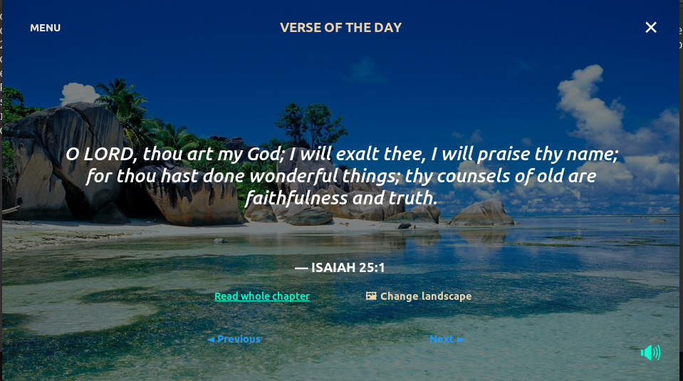
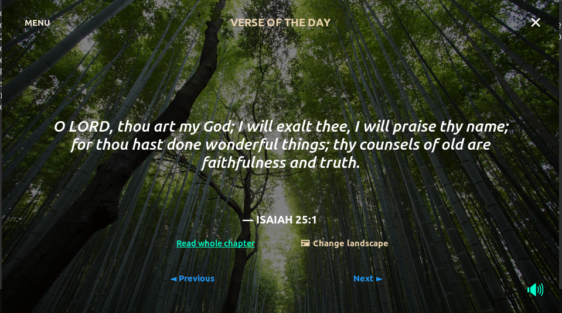
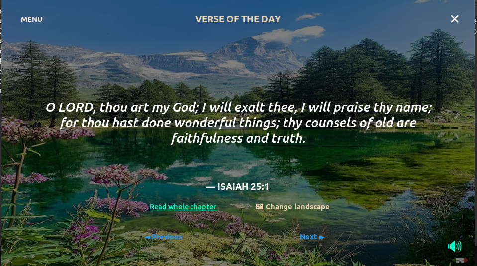
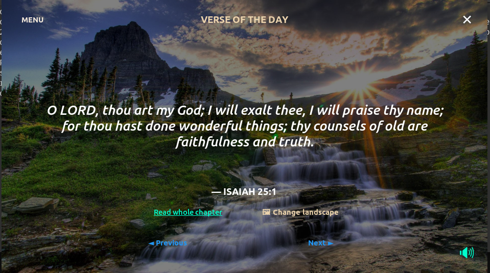

<div align="center">
  
  <h1>Presentador Bíblico / Biblical Presenter</h1>
  <p><strong>🇪🇸 Español • 🇺🇸 English • 🇫🇷 Français • 🇮🇹 Italiano • 🇧🇷 Português</strong></p>
  <a href="https://github.com/Danielbetu/Presentador-Biblico/releases/latest">
    
  </a>
</div>

---

## 🌍 Idiomas Soportados / Supported Languages

| 🇪🇸 Español | 🇺🇸 English | 🇫🇷 Français | 🇮🇹 Italiano | 🇧🇷 Português |
| :---: | :---: | :---: | :---: | :---: |
|  |  |  |  |  |
| **Reina-Valera 1960** | **King James Version** | **Louis Segond 1910** | **Riveduta / Nuova Riveduta** | **Almeida** |

---

## 🖼️ Capturas de Pantalla / Screenshots

| | |
| :---: | :---: |
|  |  |
|  |  |

---

## ✨ Características / Features

* **🇪🇸 Español:** Versículo del día, lectura de capítulos completos y Biblia entera en 5 idiomas, buscador de frases, fondos de paisajes intercambiables, música de fondo y exportación de postales listas para compartir por WhatsApp o Telegram.
* **🇺🇸 English:** Verse of the day, full chapter and complete Bible reading in 5 languages, phrase search, switchable scenic backgrounds, background music, and postcard export ready to share on WhatsApp or Telegram.
* **🇫🇷 Français:** Verset du jour, lecture de chapitres complets et de la Bible entière en 5 langues, recherche de phrases, arrière-plans de paysages interchangeables, musique de fond et exportation de cartes postales pour WhatsApp ou Telegram.
* **🇮🇹 Italiano:** Versetto del giorno, lettura di capitoli completi e della Bibbia intera in 5 lingue, motore di ricerca, sfondi paesaggistici intercambiabili, musica di sottofondo ed esportazione di cartoline per WhatsApp o Telegram.
* **🇧🇷 Português:** Versículo do dia, leitura de capítulos completos e Bíblia inteira em 5 idiomas, buscador de frases, fundos de paisagens intercambiáveis, música de fundo e exportação de cartões-postais para WhatsApp ou Telegram.

---

## 📦 Instalación en Linux / Linux Installation

1. Descargá el paquete **`PresentadorBiblico-v2.0.0.flatpak`** desde la sección [Releases](https://github.com/Danielbetu/Presentador-Biblico/releases/latest).
2. Hacé doble clic sobre el archivo descargado o ejecutá en tu terminal:
   ```bash
   flatpak install PresentadorBiblico-v2.0.0.flatpak
